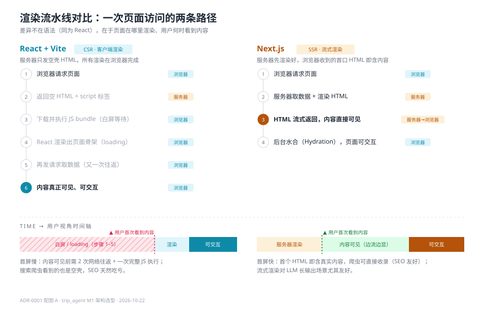
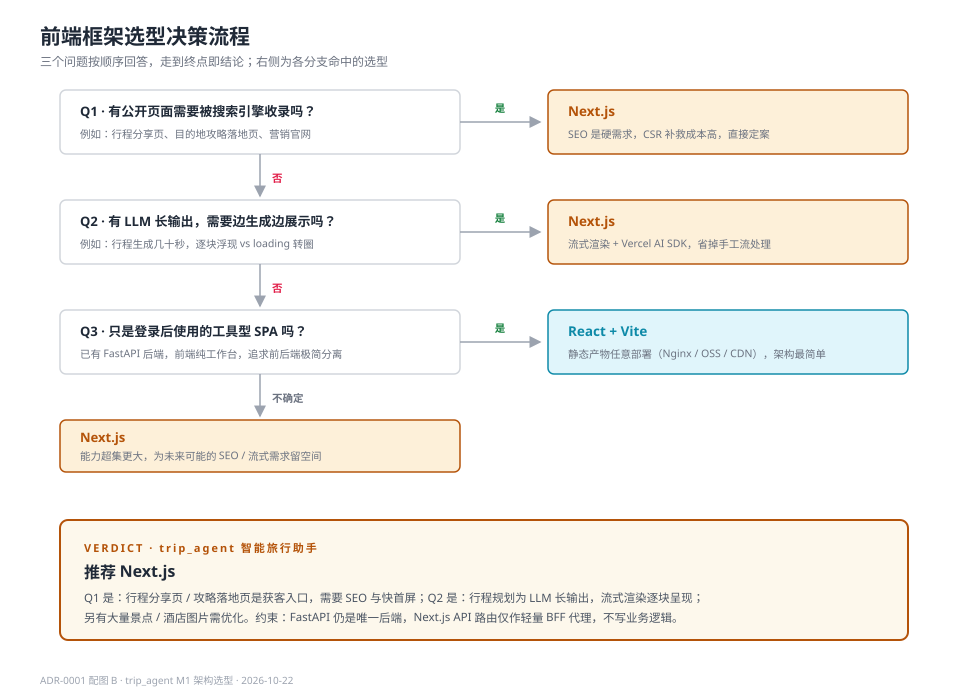

# ADR-0001 前端框架选型：Next.js

> 状态：草案 · 最后更新：2026-10-22

## 背景

trip_agent 需要一个 Web 前端，承担两类性质不同的页面：

1. **公开页面**：行程分享页（"看看我的京都 5 日游"）、目的地攻略落地页等。这类页面是天然的获客入口，需要被搜索引擎收录（SEO），且首屏速度直接影响跳出率。
2. **登录后工作台**：行程生成、行程节点编辑（增删景点并联动地图与预算）、导出等。这类页面是重交互的 SPA，SEO 无意义。

核心交互是 LLM 长输出：一次完整行程规划生成耗时可达数十秒，用户体验取决于能否"边生成边展示"（交通 → 酒店 → 景点逐块浮现），而不是 loading 转圈。

后端已确定为 Python / FastAPI（见 `docs/00-项目开发流程规范.md` 第 6 节），前端框架需在 M1 冻结，候选为 **React + Vite（纯 CSR）** 与 **Next.js（React 全栈框架）**。

## 决策

**前端框架选用 Next.js（App Router）。**

约束条件：

- FastAPI 是唯一业务后端；Next.js 的 API 路由只用作轻量 BFF / 代理层（转发鉴权、聚合请求），**不写业务逻辑**，避免双后端混乱。
- 公开页面用服务端渲染（SSR/SSG）；登录后工作台用 Client Component，两者在同一应用内共存。
- 部署需要 Node.js 运行环境（或 Vercel），具体方案在 M6 部署 ADR 中确定。

## 渲染机制差异（决策的核心依据）

两者同为 React，差异在于**页面在哪里渲染、用户何时看到内容**：

- **React + Vite（CSR）**：服务器返回空壳 HTML，浏览器需下载并执行完整 JS bundle、再发请求取数据，内容才可见。首屏经历 2 次网络往返 + 一次完整 JS 执行；搜索爬虫拿到的同样是空壳，SEO 需额外做预渲染补救。
- **Next.js（SSR / 流式渲染）**：服务器取数并渲染 HTML，首个响应即含真实内容；Suspense 流式渲染允许页面分块"流"到浏览器，数据就绪的区块随到随显。

## 选项对比

| 维度 | React + Vite | Next.js |
|---|---|---|
| 定位 | UI 库 + 构建工具，路由/数据层自行拼装 | 全栈框架，路由/渲染/缓存/图片优化内置 |
| 首屏性能 | 差：白屏等 JS 加载执行完 | 好：服务端直出 HTML |
| SEO | 差：纯 CSR 需额外预渲染 | 好：SSR/SSG 天然支持 |
| 流式 AI 输出 | 需手写 fetch + ReadableStream 处理 | Suspense 流式渲染 + Vercel AI SDK 原生支持 |
| 上手与心智负担 | 低，自由灵活，热更新极快 | 较高：需理解 Server/Client 组件边界，版本迭代快 |
| 与 FastAPI 配合 | 纯静态产物，前后端彻底解耦 | API 路由须限定为 BFF 代理，避免双后端 |
| 部署 | 任意静态托管（Nginx / OSS / CDN） | 最佳体验在 Vercel；自托管需 Node 服务 |

## 理由

按决策流程（下图），trip_agent 在前两个问题上即命中 Next.js：

1. **SEO 是硬需求**：行程分享页 / 攻略落地页承担获客职能，CSR 的预渲染补救（如 prerender.io、vite-plugin-prerender）是事后补丁，成本高于直接 SSR。
2. **流式渲染匹配核心交互**：LLM 行程生成是长输出场景，App Router + Suspense 让"交通 → 酒店 → 景点"逐块呈现，Vercel AI SDK 对生成式 UI 支持成熟；Vite 方案需手工实现流处理，工程量大。
3. **图片优化开箱即用**：行程页含大量景点 / 酒店图片，`next/image` 的懒加载与尺寸自适应无需自建。
4. **与既定建议一致**：`AGENTS.md` 技术栈建议即为 Next.js + React。

## 备选方案

**React + Vite**：在以下情形应重新评估（需新写 ADR 推翻本文）：

- 产品方向调整为纯登录后工具，砍掉所有公开页面（分享 / 落地页）；
- 团队确认无任何 Next.js 经验且无法接受学习成本，宁可手工实现流式输出与预渲染。

**其他未入选项**：Nuxt（Vue 生态，与团队 React 技能不符）、Remix（国内生态与 AI SDK 支持弱于 Next.js）、Astro（偏静态内容站，重交互工作台不匹配）。

## 影响与后续动作

- `frontend/` 目录规范在 M2 骨架阶段补充进 `docs/00-项目开发流程规范.md` 第 6 节（该节已预留："前端目录 `frontend/` 在 M1 确认技术栈后补充规范"）。
- 前端流式接口契约（FastAPI SSE / WebSocket 与 Next.js 流式渲染的对接方式）在 `docs/03-设计/api/` 中定义。
- M6 部署方案需包含 Node.js 运行时（自托管）或 Vercel 账号（托管）。
- 根目录 `react-vs-nextjs.html` 为本文的交互版对比页，仅供演示，不属于正式文档体系。

## 变更记录

| 日期 | 变更 | 说明 |
|---|---|---|
| 2026-10-22 | 初版草案 | M1 前端框架选型提案，待评审 |
